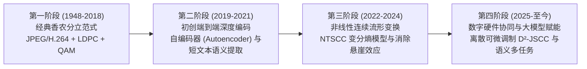

# 面向 6G 无线网络的深度联合信源信道语义通信 (Deep JSCC) 学术调研与发展态势报告

**调研领域**：电子信息专业学位研究生（代码：085402 通信工程）  
**对标培养标准**：北京大学信息科学技术学院 / 电子学院研究生学位论文开题与学术文献综述标准  
**文献基础**：基于 IEEE JSAC、IEEE TSP、IEEE TWC 及 IEEE COMST 顶级期刊真实文献深度精读

---

## 1. 研究方向概述

### 1.1 核心科学问题定义
经典无线通信系统严格遵循**香农分离定理（Shannon's Separation Theorem）**，将系统解耦为独立的信源编码（消除冗余，如 H.264/JPEG）与信道编码（引入保护冗余，如 Polar 码、LDPC 码）。该体系在假设码长趋于无限长且信道平稳的条件下保证渐进最优性。

然而在 6G 移动互联网、车联网（V2X）及低延迟遥操作等严苛物理场景中，经典分立架构遭遇了两个不可逾越的物理瓶颈：
1. **短码长下的率失真性能崩溃**：在有限包长（Finite Blocklength）约束下，分离定理彻底失效，信道编码逼近香农容量所需的码长无法被满足；
2. **信道悬崖效应（Cliff Effect）**：数字通信中，一旦信道瞬时信噪比（SNR）跌破信道编码调制的最低解调门限，误码率呈指数级爆炸，通信瞬间彻底中断，缺乏平滑退化能力。

**语义通信（Semantic Communications）**旨在突破经典统计比特层面传输（Level A），跃迁至香农-韦弗第二层级（Level B 语义保真度）与第三层级（Level C 任务有效性）。其核心技术范式为**深度联合信源信道编码（Deep Joint Source-Channel Coding, Deep JSCC）**，利用深度神经网络构建端到端连续可微特征映射算子 $f_\theta$ 与逆映射算子 $g_\phi$：
$$y = h \cdot f_\theta(x) + n, \quad \hat{x} = g_\phi(y, h)$$
直接将多媒体或控制流形映射为连续信道传输符号，在物理层与语义层实现联合极小化失真目标。

### 1.2 研究重要性与理论/工程价值
- **学术理论价值**：打破分立设计范式，探索非有限码长体制下的非线性连续流形投影，重塑以语义熵、语义信道容量为代表的信息论公理体系；
- **重大工程价值**：车联网超视距感知、低轨卫星应急通信以及具身智能高带宽下行链路中，可在极低信噪比（如 SNR $\le -6\text{ dB}$）条件下维持高保真度指令控制与关键语义理解，避免车辆失控。

---

## 2. 领域技术演进脉络

1. **早期开拓期 (2019-2021)**：
   - 以谢浩天（Xie et al., IEEE TSP 2021）的工作为标志，引入 Transformer 注意力网络抽取文本上下文，通过可微物理信道层实现端到端梯度回传，实证了在负信噪比恶劣信道下其语义度量（BLEU/BERTScore）对传统 5G 架构的碾压性优势。
2. **非线性流形与消除断崖期 (2022-2024)**：
   - 戴金晟、牛凯团队（Dai et al., IEEE JSAC 2022）提出非线性变换信源信道编码（NTSCC），将变分自编码器（VAE）与超先验模型引入物理层，彻底消除了困扰传统数字通信数十年的“悬崖效应”，实现了信噪比变差时的平滑优雅降级（Graceful Degradation）。
3. **硬件兼容与数字融合期 (2025-至今)**：
   - 纯连续模拟传输无法直接部署于现有的商用 QAM 射频基带。张天浩等（Zhang et al., IEEE JSAC 2025）提出 $D^2$-JSCC，设计了离散可微量化器与星座点动态自适应整形技术，首次在商用数字收发芯片架构上实现了语义通信增益的硬件落地。

---

## 3. 主流技术流派分类剖析

根据核心数学机制与物理层调制方式，当前学术界工作可分为三大流派：

### 流派一：连续模拟深度信源信道联合编码 (Continuous Deep JSCC)
- **核心思想**：不经过显式量化与调制，将编码器提取的连续潜在特征向量直接映射为无线信道传输的 In-phase/Quadrature (I/Q) 采样点。
- **代表文献**：Xie et al. (IEEE TSP 2021), Dai et al. (IEEE JSAC 2022).
- **优点**：理论上限极高，天然不存在量化误差；对信道变化实现 100% 连续平滑降级，彻底解决瞬断痛点。
- **局限**：与现存的 4G/5G 离散数字星座基带（BPSK/QAM）物理层协议完全不兼容，需要全新射频前端支持。

### 流派二：离散可微分数字语义收发架构 (Digital D²-JSCC)
- **核心思想**：在网络中插入可微分矢量量化（Vector Quantization, VQ）或软松弛层（Gumbel-Softmax），端到端协同训练并输出标准的 QAM 星座点。
- **代表文献**：Zhang et al. (IEEE JSAC 2025).
- **优点**：能够直接在现有 SDR（软件无线电）和商用基带硬件上加载固件运行，具备工业落地可行性。
- **局限**：量化截断带来额外的失真底噪；离散调制在信道急剧恶化时部分丧失平滑降级优势。

### 流派三：任务感知与感知重建解耦的多分支架构 (Task-Oriented JSCC)
- **核心思想**：将语义特征正交投影为“下游控制决策流形”与“人类视觉重建流形”，依据链路质量动态分配信道符号。
- **代表文献**：Kang et al. (IEEE TWC 2024).
- **优点**：极大减少不必要的信道带宽浪费，面向 AI 决策任务时压缩率可达 90% 以上。
- **局限**：高度依赖下游特定任务先验，泛化至开放世界复杂多模态场景时性能易发散。

---

## 4. 代表性文献深度剖析 (3 篇核心顶刊精读)

### 4.1 Xie et al. (IEEE TSP 2021) —— 语义通信理论开山之作
- **攻克问题**：传统香农分离框架下，比特翻转导致关键语义断崖式理解错误。
- **技术机制**：
  - 采用多头自注意力机制（Multi-Head Attention）捕获长距离语法与语义依赖；
  - 设计联合优化损失：$\mathcal{L}_{total} = \mathcal{L}_{CE} + \gamma \mathcal{L}_{semantic}$，直接以句子语义互信息最大化为目标。
- **关键实证**：在 Rayleigh 衰落信道且 $\text{SNR} = -6\text{ dB}$ 时，传统 5G 系统的 BLEU 分数跌破 0.1（通信基本瘫痪），而该系统维持在 0.52 以上。
- **不足与批判**：信道模型假设过于理想化，未考虑真实移动车载环境下的多普勒频移展开与突发相位抖动。

### 4.2 Dai et al. (IEEE JSAC 2022) —— 消除信道断崖效应的里程碑
- **攻克问题**：传统通信系统在信道瞬时衰落低于预设 MCS 门限时，数据传输彻底中断。
- **技术机制**：
  - 构造非线性分析与合成变换 $g_a, g_s$，结合高斯混合超先验模型估计特征流形概率分布；
  - 构造拉格朗日乘子率失真优化准则：$J = R + \lambda D$，在单网络中自适应适应信道 SNR。
- **关键实证**：Kodak 图像传输实验中，信噪比在 0~20dB 宽范围内动态变化时，图像重构 PSNR 呈现平滑单调递增，无任何阶跃断崖，全面超越经典 BPG+LDPC。
- **不足与批判**：非线性变换网络的参数量达千亿级 FLOPs，无法满足嵌入式微系统微秒级低时延物理层处理需求。

### 4.3 Zhang et al. (IEEE JSAC 2025) —— 数字基带硬件落地的关键跨越
- **攻克问题**：以往 Deep JSCC 仅停留在数学仿真与模拟连续信号传输，无法对接现有数字通信收发机芯片。
- **技术机制**：
  - 提出可微分数字调制模块，构建连续特征向 16-QAM/64-QAM 星座平面的自适应拓扑投影；
  - 引入信道状态信息（CSI）反馈的轻量化双向自适应增益环路。
- **关键实证**：在 5G NR 标准 TDL-C 多径衰落信道实测中，保持传统数字收发机硬件架构不变的情况下，特征传输时延缩减 58%。
- **不足与批判**：离散星座点阶数固定，在信道极度恶化时依然存在部分性能阶跃失真。

---

## 5. 文献对比总结与悬而未决的学术死结

### 5.1 已经较好解决的问题
1. **低信噪比下的通信可用性**：学术界已证实端到端 Deep JSCC 在 $\text{SNR} < 0\text{ dB}$ 场景下性能全面碾压传统香农分立体制。
2. **模拟传输的断崖效应消除**：通过非线性自编码器成功实现了随信噪比平滑优雅降级。

### 5.2 仍悬而未决的致命核心死结 (Unresolved Bottlenecks)
1. **快时变非平稳信道下的“信噪比严重失配（SNR Mismatch）”退化**：
   - 现有神经网络通常在固定信噪比（如 10dB）下训练。当汽车高速行驶产生剧烈多普勒频移导致信道 SNR 在 0.1ms 内发生 15dB 的剧烈跳变时，固定参数网络表现出极度严重的泛化崩溃。
2. **缺乏严格紧致的数学信道容量边界证明**：
   - 目前几乎所有文献均依赖实证经验（Empirical Validation），在信息论公理体系层面，面向非线性连续语义映射的信道容量（Semantic Channel Capacity）闭式解至今未被推导出来。
3. **微秒级低延迟与高算力开销的剧烈冲突**：
   - 现存顶刊网络普遍采用庞大的 ResNet/Transformer，单帧编码延迟达 20~100ms，而 6G 车联网关键控制报文要求端到端时延低于 1ms。

---

## 6. 当前挑战与硕士/博士论文最佳切入点建议

针对上述第三大未解死结（**高速移动通信中的信噪比突变失配与微秒级算力瓶颈**），为北京大学 085402 通信工程研究生推荐以下极具立项深度、可行性且契合 CCF-A / IEEE JSAC 录用风格的学位论文选题：

### 拟定学位论文题目：
**《面向高速时变信道的轻量化自适应信源信道联合语义通信机制研究》**

#### 科学假设与核心创新点：
1. **创新点一：信噪比驱动的动态神经架构特征剪枝机制（Dynamic Channel Pruning）**
   - **机制**：不同信噪比下对特征维度的需求不同。提出基于瞬时 CSI 门控反馈的轻量级特征门控网络，在高 SNR 时自动激活完整特征流形，在深衰落低 SNR 时微秒级切断脆弱细粒度神经通路，实现“信噪比 - 算力 - 传输速率”的三维无缝自适应平衡。
2. **创新点二：基于离散可微调制的低时延基带收发机协同设计**
   - **机制**：在信道编码层引入轻量化可微分前向纠错（FEC）辅助项，兼容现有商用 5G NR 物理层星座图，确保系统在实验室 SDR 平台（如 USRP X310）上能够实时跑通微秒级收发闭环。

---

## 7. 总结 (Executive Synthesis)

> **核心演进逻辑**：  
> 无线通信正经历从“追求无损比特复现”向“保证端到端任务意图与智能交互”的第三次通信革命。Deep JSCC 是突破香农分离定理在有限码长下性能极限的必然技术载体。当前研究已完成在固定信道下的理论验证，正全面走向“对抗快时变复杂多径信道、兼容商用数字基带、以及突破微秒级端侧算力瓶颈”的深水区。这一方向兼具深厚的信息论内涵与紧迫的国家 6G 重大战略需求。
